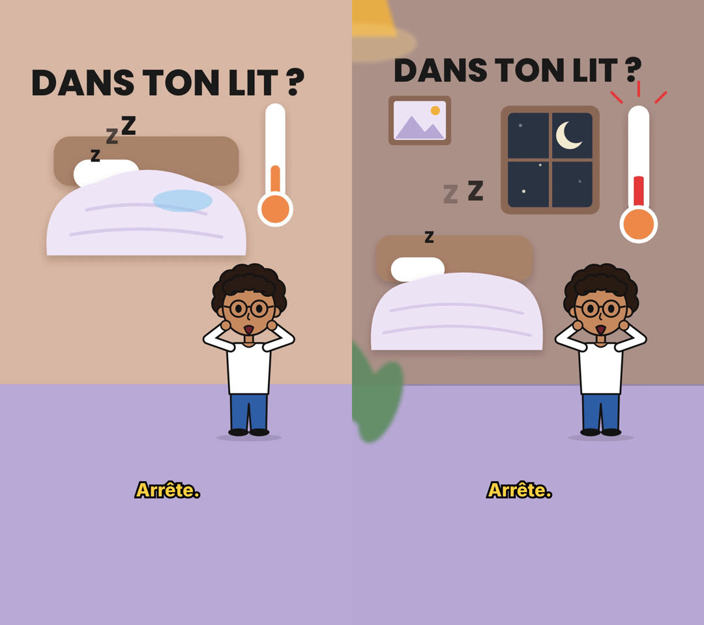
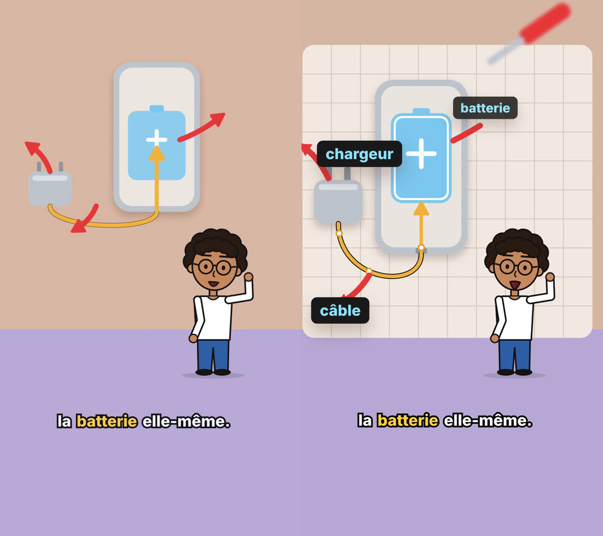
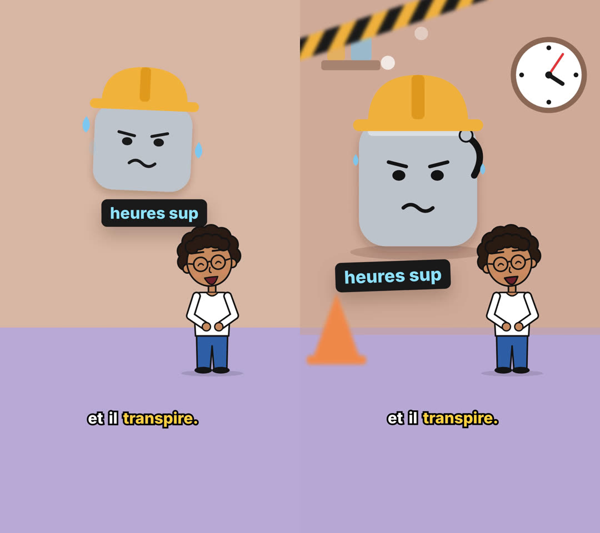
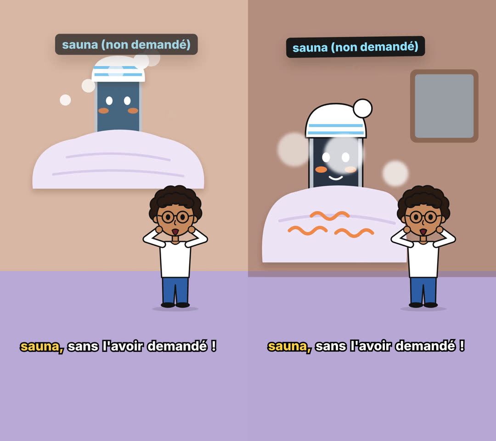
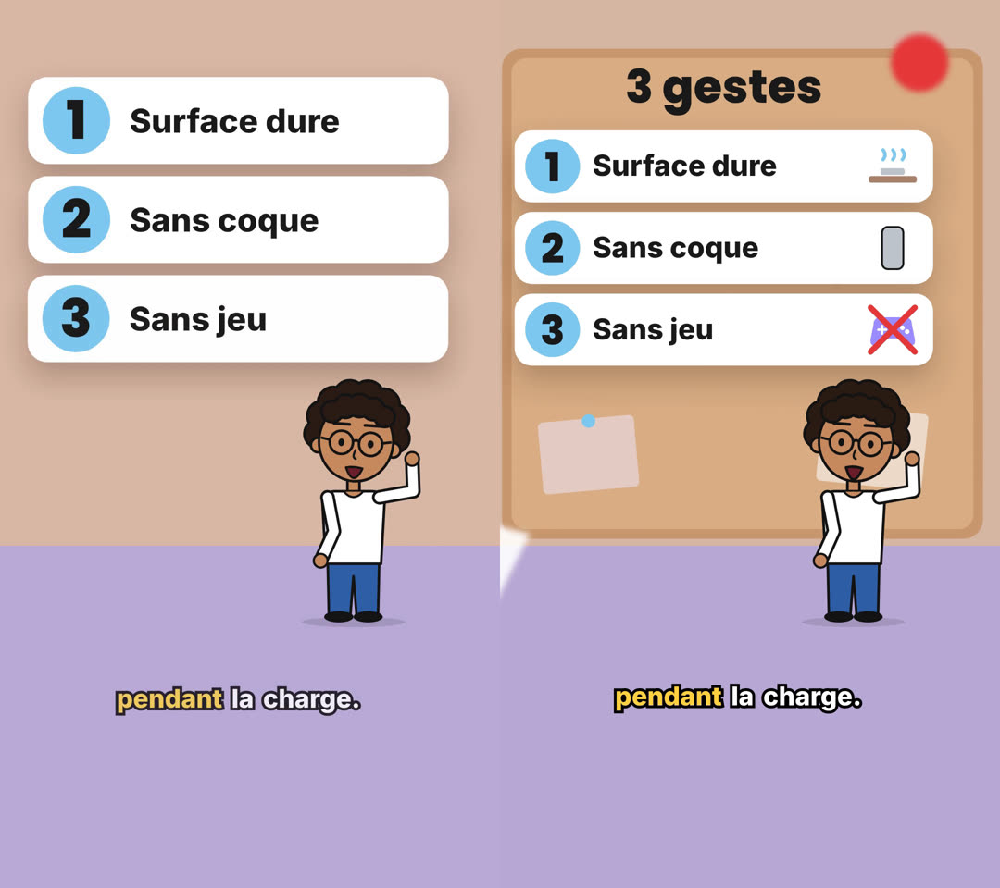
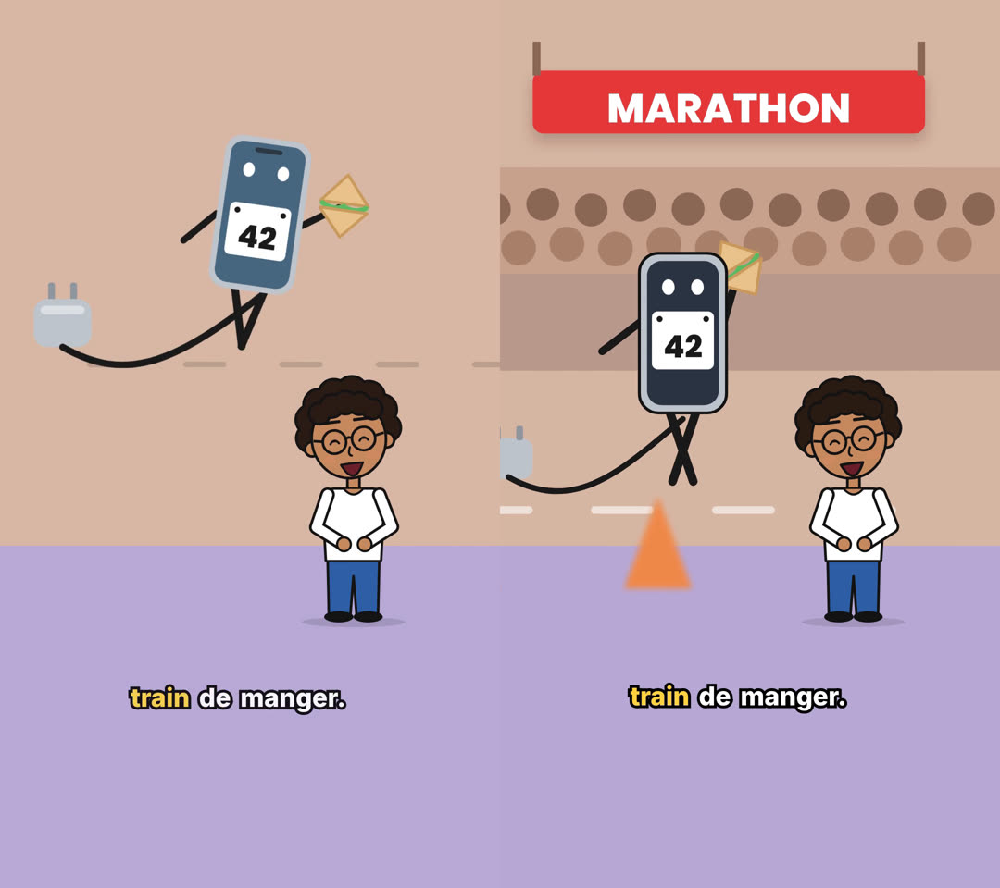

# Comparaison des moteurs : Remotion et HyperFrames (Astuces #1)

Essai sur la branche `essai-hyperframes`. Même script (`channels/astuces/scripts/001-telephone-chauffe.md`), même voix (`public/audio/astuces-001.wav`), même calage des mots, mêmes scènes, même avatar, mêmes sous-titres.

| | Remotion | HyperFrames |
| --- | --- | --- |
| Fichier | `out/astuces-001.mp4` (inchangé) | `out/astuces-001-hyperframes.mp4` |
| Source | `src/compositions/astuces-001/` | `hyperframes/astuces-001/` |
| Format | 1080x1920, 30 i/s, 55,5 s | 1080x1920, 30 i/s, 55,5 s |
| Temps de rendu, 2 processus Chrome | **126 s** | 168 s |
| Temps de rendu, réglage par défaut | 126 s (2 processus) | 269 s (1 seul processus choisi automatiquement) |
| Taille | **14,1 Mo** | 20,8 Mo (qualité `delivery`) |
| Bruitages | aucun | 27 (pop, whoosh, ding), crête -18 dBFS |
| Volume intégré | -21,3 LUFS | -18,4 LUFS (voir « Son ») |

Machine : conteneur à 4 processeurs, 15 Go de mémoire, sans carte graphique (rendu logiciel). Les tailles ne se comparent pas à qualité égale : chaque moteur garde son réglage d'encodage par défaut.

## Images comparées

Six images prises aux mêmes instants : Remotion à gauche, HyperFrames à droite.

| Instant | Scène | Image |
| --- | --- | --- |
| 2,5 s | 1. Accroche |  |
| 16,5 s | 2. Coupe du téléphone |  |
| 23,2 s | 3. Gag du chargeur |  |
| 30,8 s | 5. Gag du sauna |  |
| 46,9 s | 7. Trois cartes |  |
| 51,3 s | 8. Gag du marathon |  |

## Ce qui a été ajouté dans la version HyperFrames

Les règles visuelles demandées s'appliquent à chaque scène :

- **Trois plans de profondeur**, déplacés à des vitesses différentes (parallaxe), avec un léger mouvement de caméra :
  - au fond : chambre de nuit avec fenêtre et étoiles, planche d'atelier, pointeuse, étagère de labo, tableau en liège, tribune ;
  - au premier plan, flou : abat-jour, tournevis, ruban de chantier, tasse, vapeur, fiole, punaise, plots, plante.
- **Un nouvel élément toutes les 1,5 à 3 s**, calé sur le mot prononcé.
- **Animations GSAP** :
  - rebonds ;
  - écrasement et étirement (chutes, atterrissages) ;
  - apparitions en cascade ;
  - flèches et croix qui se dessinent ;
  - électrons qui suivent le câble ;
  - compteur de batterie qui descend par paliers.
- **Gags animés** : le chat qui sort de la couette, le téléphone en masque de nuit, le chargeur qui s'essuie le front, le téléphone en serviette, la manette barrée, la bouchée du sandwich.
- **Avatar** : même dessin et mêmes poses, plus une petite « prise » à chaque changement de pose (écrasement puis retour).
- **Bruitages** : synthétisés en local avec ffmpeg, crête à -18 dBFS. Chacun a une cause à l'écran : changement de scène, étiquette, carte, chiffre.

## Son

- **Niveau des bruitages** : mesuré en soustrayant la piste Remotion de la piste HyperFrames. Ils sortent à -18 dBFS là où ils sont placés, et le résidu reste à -50 dB ailleurs. Ils sont donc 14 à 17 dB sous les crêtes de la voix.
- **Écart de volume global (3 dB)** : il ne vient pas des bruitages. Remotion baisse de 3 dB la voix mono en la passant en stéréo ; HyperFrames garde son niveau d'origine.
- **Limite** : tout est mesuré, rien n'a été écouté.
- **Écart avec la documentation HyperFrames** : la doc déconseille les « tonalités et dings synthétisés ». J'ai suivi la demande (bruitages générés en local) plutôt que cette recommandation.

## Verdict

### La plus riche visuellement : HyperFrames, nettement

C'est visible sur chaque paire d'images :
- décors complets plutôt qu'un objet seul sur un mur uni ;
- premier plan flou ;
- beaucoup plus d'éléments animés par scène ;
- bruitages.

**Honnêtement**, cette richesse vient surtout du travail de dessin et des nouvelles règles, pas du moteur. Rien de ce qui a été fait ici n'est impossible dans Remotion : `spring`, `interpolate`, des tracés SVG et des balises `<Audio>` suffisent. GSAP rend certaines choses plus rapides à écrire : rebonds et élastiques prêts à l'emploi, cascades, `fromTo`. Pour comparer les moteurs à égalité, il faudrait appliquer les mêmes règles à la version Remotion.

### La plus facile à maintenir dans ce dépôt : Remotion

Pour Remotion :

- **Une seule source** : l'avatar, les sous-titres, le parseur et le calage sont des modules TypeScript typés, partagés par toutes les vidéos. Dans l'essai HyperFrames, il a fallu :
  - **copier l'avatar** (`compositions/avatar.html`) : deux versions à garder identiques ;
  - **ajouter une étape de génération** (`scripts/hyperframes-astuces-001.ts`) : elle produit la racine et les sous-titres, et ses données de calage sont figées dans `index.html` (à relancer si le script ou la voix changent).
- **Moins de code** : environ 800 lignes propres à la vidéo côté Remotion, contre environ 1 900 écrites à la main côté HyperFrames. Les scènes y sont plus fournies, mais il y a aussi les 250 lignes de l'avatar recopié.
- **Plus rapide à rendre, fichiers plus légers.**
- **Moins de dépendances extérieures** : HyperFrames a demandé :
  - un plugin installé ;
  - une version du logiciel figée par projet ;
  - un Chrome supplémentaire de 114 Mo.

Pour HyperFrames :

- **Lisibilité** : une scène est un fichier HTML lisible, facile à retoucher visuellement.
- **Contrôles intégrés** : `lint`, `check` et `snapshot` ont repéré de vrais défauts dès les premiers essais :
  - éléments mal placés ;
  - compteur faux ;
  - pistes audio qui se chevauchent.
- **Édition sans code** : l'application HyperFrames (« Studio ») permet de déplacer, raccourcir ou retimer des éléments sans coder. Je ne l'ai pas testée : pas d'interface graphique dans ce conteneur.

### Recommandation

Garder Remotion comme moteur et y reporter les règles visuelles. Pour cela :
- ajouter quelques utilitaires équivalents à `scene-kit.js` : apparition avec rebond, chute avec écrasement, tracé qui se dessine, parallaxe à trois plans ;
- ajouter les bruitages via `<Audio>`.

HyperFrames ne vaut le passage complet que si quelqu'un d'autre doit retoucher les vidéos sans coder. Dans ce cas, il faudrait migrer pour de bon (avatar et sous-titres une seule fois) et retirer la version Remotion, pour ne pas entretenir deux moteurs.

## Ce qui n'a pas été fait

- **Pas de Whisper** : comme pour la version Remotion, le calage est la répartition au prorata des lettres, ancrée sur les pauses de la voix. HyperFrames propose `npx hyperframes transcribe`, mais le modèle se télécharge depuis huggingface.co, bloqué ici.
- **Étapes HyperFrames sautées** : pas de « trois idées d'histoire » ni de `SPEC.md` (les scènes étaient imposées), pas de `REVIEW.md`. Les contrôles ont été faits avec `check` et des captures d'écran à chaque scène.
- **Pas de musique**, conformément à CLAUDE.md.
- **Pas d'avis envoyé à HeyGen** (`hyperframes feedback`).

## Reproduire

```bash
# Remotion
npx remotion render Astuces001 out/astuces-001.mp4

# HyperFrames (plugin hyperframes@hyperframes installé)
npx tsx scripts/hyperframes-astuces-001.ts      # recalcule le calage, la racine et les sous-titres
node ~/.claude/plugins/marketplaces/hyperframes/skills/hyperframes/scripts/plugin-cli.mjs \
  render hyperframes/astuces-001 --quality delivery --workers 2 --output out/astuces-001-hyperframes.mp4
```
